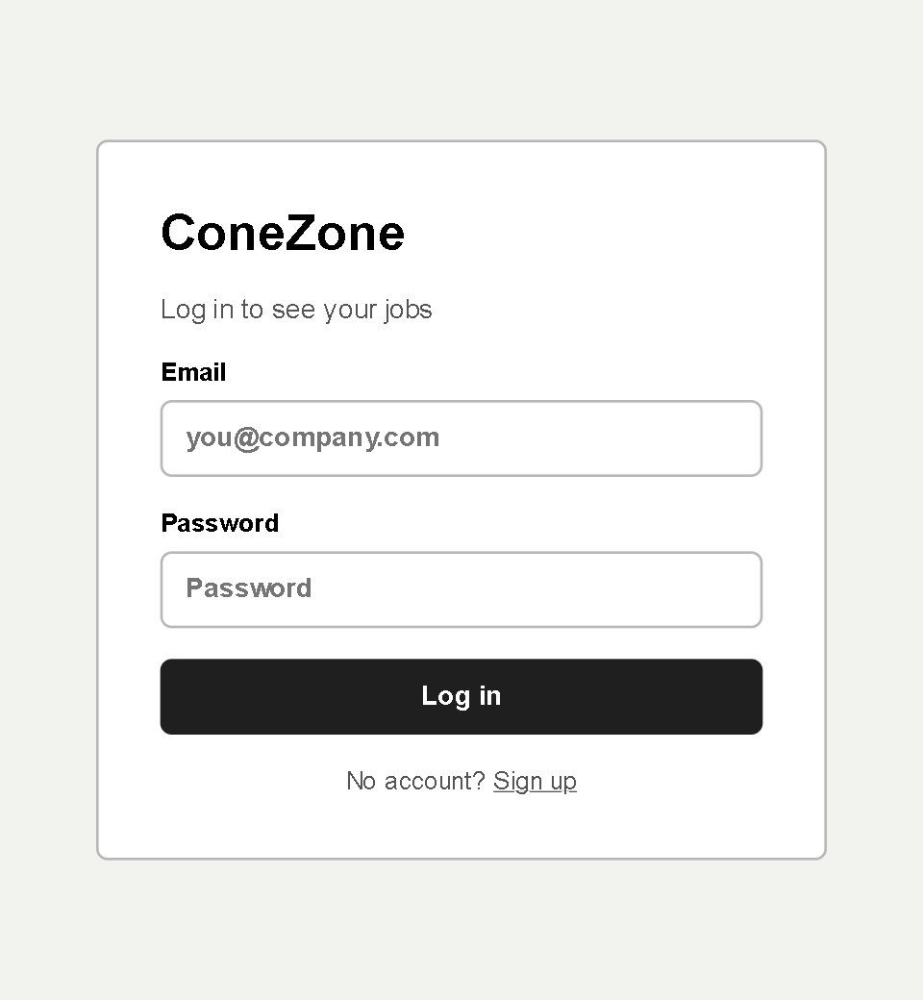
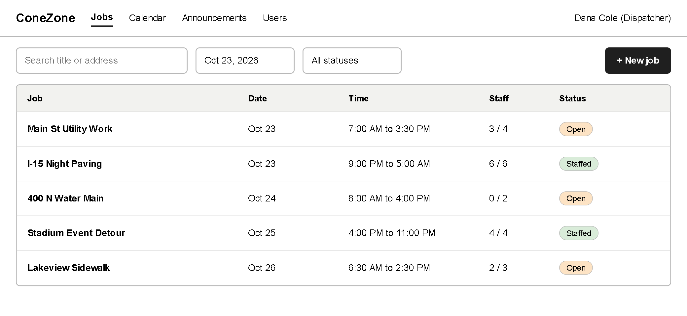
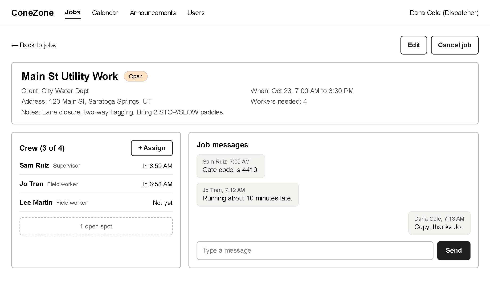
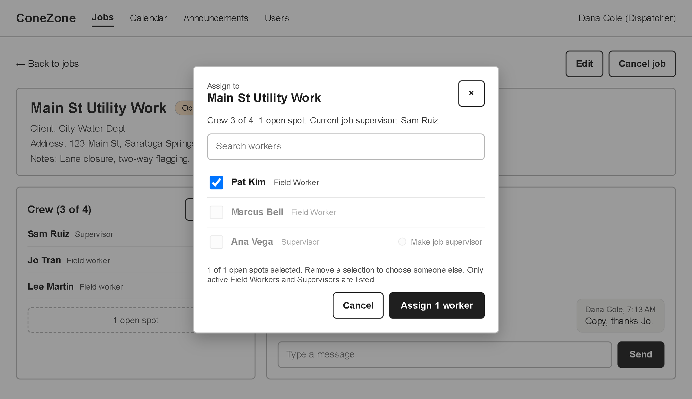
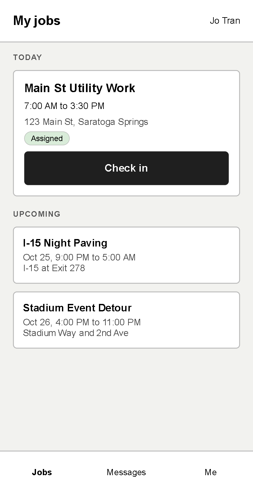
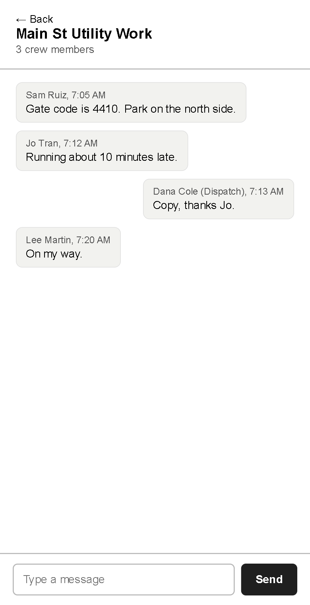
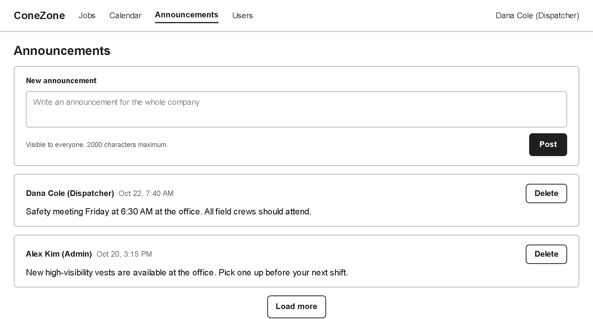
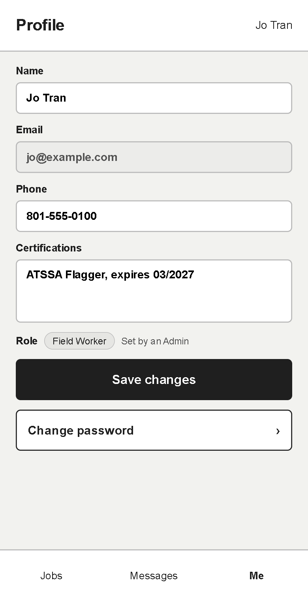
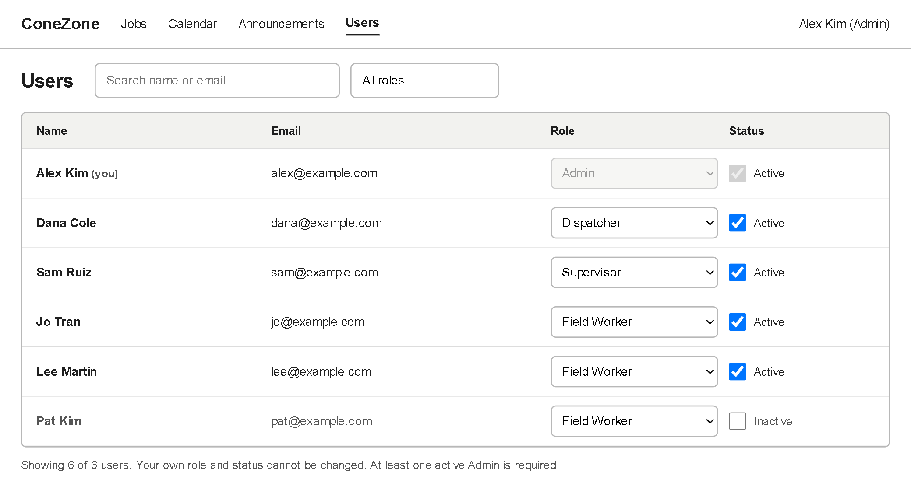

# ConeZone: Traffic Control Job Board & Crew Communication App

**Project Specification** | Author: \[Your Name\] | Course: \[Course Name\] | Date: \[Date\]

*Note: "ConeZone" is a placeholder name. Rename it however you like.*

## 1. Project Description

Traffic control companies place flaggers, signs, cones, and arrow boards around road work, utility jobs, and events. Day to day, a lot of that coordination happens through phone calls, group texts, whiteboards, and spreadsheets. Dispatchers juggle which crews go where, supervisors need to know who showed up, and field workers want one clear place to see where they are going, when, and what gear to bring. Information gets lost, and people end up scrolling through long text threads to find an address.

**ConeZone** is a web app that gives a traffic control company a single place to:

- Post and track **jobs** (a job board with status, location, schedule, and requirements)
- **Assign** field workers and supervisors to jobs
- **Communicate** about each job in a dedicated message thread, plus send company-wide announcements
- Let field workers **check in and out** of jobs from their phones

The problem it solves is simple: *everyone involved in a job sees the same up-to-date information, and every conversation about a job lives with that job.*

There are existing tools (scheduling software, group chat apps, field service platforms), but they tend to be either too generic or too heavy. This project focuses on a lean, role-aware tool built around the way a traffic control crew actually works: dispatcher posts, supervisor runs the site, flaggers show up and check in.

### Out of scope (to keep this a 10-week project)

- Payroll, invoicing, or billing
- GPS tracking or route optimization
- Uploading or editing traffic control plan (TCP) drawings (jobs may simply link to a document or contain notes)
- Equipment/inventory management
- Native mobile apps (the web app must simply work well on phones)

## 2. Target Audience and User Roles

The primary customer is a small to mid-size traffic control company (roughly 10 to 100 employees). Users fall into four roles, and what they can see and do depends on their role.

| Role                   | Who they are                          | What they need                                                                         |
| ---------------------- | ------------------------------------- | -------------------------------------------------------------------------------------- |
| **Admin**        | Office manager or owner               | Manage user accounts, assign roles, see everything, archive old data                   |
| **Dispatcher**   | Office-based scheduler                | Create and edit jobs, assign crews, send announcements, monitor job status             |
| **Supervisor**   | Lead on site, runs a crew             | See assigned jobs, update job status, message their crew, review who has checked in    |
| **Field Worker** | Flagger or traffic control technician | See *their* upcoming jobs, view details and notes, check in/out, message about a job |

### Example user stories

- *As a dispatcher,* I want to create a job with an address, start time, and number of workers needed so my crews know where to be.
- *As a dispatcher,* I want to see which jobs are still understaffed so I can fix them before the day starts.
- *As a supervisor,* I want to message everyone on my job at once so I do not have to text each person.
- *As a field worker,* I want to open my phone and instantly see where I am working tomorrow and what time to arrive.
- *As a field worker,* I want to check in when I arrive so my supervisor knows I am on site.
- *As an admin,* I want to create accounts and set roles so only the right people can create or edit jobs.

## 3. Core Features (MVP)

The MVP is the smallest version of the app that is actually useful. Everything here must work by the end of the project.

### 3.1 Authentication and Profiles

- Sign up, log in, log out
- Each user has a role (Admin, Dispatcher, Supervisor, Field Worker)
- New accounts start as Field Worker; an Admin can change roles
- Profile page: name, phone number, certifications (free text, e.g., "ATSSA Flagger, expires 03/2027"), and password change

### 3.2 Job Board (CRUD)

- **Create** a job (Dispatcher/Admin): title, client name, address, date, start time, end time, workers needed, notes, status
- **Read** a job board listing with all jobs; filter by date and status; search by title or address
- **Update** a job (Dispatcher/Admin; Supervisors may update only the status of their own jobs)
- **Delete** a job (Admin/Dispatcher; consider "cancelled" status as the usual alternative)
- Job statuses: `Open`, `Staffed`, `In Progress`, `Completed`, `Cancelled`

### 3.3 Job Assignments

- Dispatchers assign users to a job, and one assigned user is marked as the **Supervisor** for that job
- A job shows "Staffed 3 of 4" so understaffing is visible at a glance
- Field workers see a **My Jobs** view containing only jobs they are assigned to

### 3.4 Messaging (CRUD)

- Each job has its own **message thread**, visible only to people assigned to that job plus Dispatchers and Admins
- **Create** a message; **Read** the thread; **Edit** or **Delete** your own messages
- Company-wide **announcements** posted by Dispatchers/Admins and visible to everyone

### 3.5 Check-In / Check-Out

- Assigned workers can tap "Check In" and "Check Out" on a job
- Supervisors and Dispatchers can see who has checked in and the timestamps

### 3.6 Role-Based Access Control (Advanced Feature #1, required for MVP)

Permissions are enforced both in what the interface shows *and* in what the server will allow. See the permissions table below.

| Action                      | Field Worker | Supervisor             | Dispatcher | Admin   |
| --------------------------- | ------------ | ---------------------- | ---------- | ------- |
| View own assigned jobs      | Yes          | Yes                    | Yes        | Yes     |
| View all jobs               | No           | No                     | Yes        | Yes     |
| Create / edit / delete jobs | No           | Status only (own jobs) | Yes        | Yes     |
| Assign workers to jobs      | No           | No                     | Yes        | Yes     |
| Post in a job thread        | Own jobs     | Own jobs               | Any job    | Any job |
| Post announcements          | No           | No                     | Yes        | Yes     |
| Check in / out              | Own jobs     | Own jobs               | No         | No      |
| View check-in log           | No           | Own jobs               | Yes        | Yes     |
| Manage users and roles      | No           | No                     | No         | Yes     |

### 3.7 Responsive Design

- Field Worker screens are designed **mobile first** (large buttons, readable outdoors in sunlight)
- Dispatcher and Admin screens are designed **desktop first** but must still be usable on a tablet

## 4. Additional Features

These will be done in priority order *after* the MVP is stable. Feature #1 is the second advanced feature the project commits to.

1. **Real-time updates (Advanced Feature #2).** New messages, job status changes, and check-ins appear on other users' screens without refreshing the page. An unread message indicator is shown on each job.
2. **Notifications.** An in-app notification list ("You were assigned to Main St Utility Work", "Job time changed"), with unread count in the header.
3. **Calendar view** of jobs (week view) for Dispatchers.
4. **Conflict warning.** When assigning a worker, warn if they already have a job that overlaps in time.
5. **Offline-friendly job view (Advanced Feature #3, stretch).** Field workers can still open their last-loaded jobs when they have no cell signal (common in rural work zones).
6. **Third-party map link or embedded map** showing the job address.
7. **Text/SMS alerts** for urgent changes (third-party messaging service).
8. **Job templates / duplicate job** for recurring work.
9. **CSV export** of the check-in log for timesheet help.

## 5. Wireframes

These are low-fidelity sketches. Final layout, colors, and branding are up to the team. (The class can replace these with Figma or hand-drawn versions; the screens and contents are what matter.)

### 5.1 Login / Sign Up

### 5.2 Job Board (Dispatcher, desktop)

### 5.3 Job Detail (Dispatcher / Supervisor)

### 5.3a Assign Workers (modal)

### 5.4 My Jobs (Field Worker, mobile)

### 5.5 Job Thread (mobile)

### 5.6 Announcements (Dispatcher) and Profile (Field Worker - Mobile)

### 5.7 Admin: Manage Users (desktop)

## 6. Initial Data Models

Field types are described generically. Teams will choose how to store them. Every record also has an `id`, `created_at`, and `updated_at`.

### User

| Field          | Type    | Notes                                                                                  |
| -------------- | ------- | -------------------------------------------------------------------------------------- |
| name           | text    | required                                                                               |
| email          | text    | required, unique                                                                       |
| password       | text    | stored securely, never plain text                                                      |
| phone          | text    | optional                                                                               |
| certifications | text    | free text                                                                              |
| role           | enum    | `admin`, `dispatcher`, `supervisor`, `field_worker` (default `field_worker`) |
| is\_active     | boolean | deactivate instead of deleting                                                         |

### Job

| Field                   | Type              | Notes                                                                |
| ----------------------- | ----------------- | -------------------------------------------------------------------- |
| title                   | text              | required                                                             |
| client\_name            | text              |                                                                      |
| address                 | text              | required                                                             |
| date                    | date              | required                                                             |
| start\_time / end\_time | time              | required                                                             |
| workers\_needed         | integer           | default 1                                                            |
| notes                   | text              |                                                                      |
| status                  | enum              | `open`, `staffed`, `in_progress`, `completed`, `cancelled` |
| created\_by             | reference to User | the dispatcher/admin                                                 |

### Assignment (connects Users and Jobs, many-to-many)

| Field               | Type              | Notes               |
| ------------------- | ----------------- | ------------------- |
| job                 | reference to Job  |                     |
| user                | reference to User |                     |
| is\_job\_supervisor | boolean           | at most one per job |
| checked\_in\_at     | datetime          | nullable            |
| checked\_out\_at    | datetime          | nullable            |

### Message

| Field            | Type              | Notes                                           |
| ---------------- | ----------------- | ----------------------------------------------- |
| job              | reference to Job  | nullable; empty means company-wide announcement |
| author           | reference to User |                                                 |
| body             | text              | required                                        |
| is\_announcement | boolean           |                                                 |
| edited\_at       | datetime          | nullable                                        |

### Notification *(additional feature)*

| Field    | Type              | Notes                                                |
| -------- | ----------------- | ---------------------------------------------------- |
| user     | reference to User | recipient                                            |
| type     | text              | e.g., `assigned`, `job_changed`, `new_message` |
| job      | reference to Job  | optional                                             |
| is\_read | boolean           |                                                      |

### Relationships

- A **User** has many **Assignments**, **Messages**, and **Notifications**
- A **Job** has many **Assignments** and **Messages**
- A **User** and a **Job** are connected through **Assignment** (many-to-many)

**CRUD coverage:** Job (full CRUD), Message (full CRUD), Assignment (create/read/update/delete), User (create/read/update/deactivate).

## 7. API Endpoints

All endpoints except sign up and log in require an authenticated user. "Roles" lists who may call the endpoint; everyone else receives a *forbidden* response. Endpoint paths are illustrative and may change during implementation.

### Auth and Users

| Method | Path                       | Purpose                                           | Roles             |
| ------ | -------------------------- | ------------------------------------------------- | ----------------- |
| POST   | `/api/auth/register`     | Create account                                    | Public            |
| POST   | `/api/auth/login`        | Log in                                            | Public            |
| POST   | `/api/auth/logout`       | Log out                                           | Any               |
| GET    | `/api/users/me`          | Get my profile                                    | Any               |
| PUT    | `/api/users/me`          | Update my profile                                 | Any               |
| PUT    | `/api/users/me/password` | Change password                                   | Any               |
| GET    | `/api/users`             | List users (supports `?role=` and `?search=`) | Dispatcher, Admin |
| PUT    | `/api/users/:id/role`    | Change a user's role                              | Admin             |
| PUT    | `/api/users/:id/active`  | Activate / deactivate user                        | Admin             |

### Jobs

| Method | Path                     | Purpose                                                                                        | Roles                                    |
| ------ | ------------------------ | ---------------------------------------------------------------------------------------------- | ---------------------------------------- |
| GET    | `/api/jobs`            | List jobs (`?date=`, `?status=`, `?search=`); workers and supervisors get only their own | Any (filtered by role)                   |
| GET    | `/api/jobs/:id`        | Job detail with crew                                                                           | Assigned users, Dispatcher, Admin        |
| POST   | `/api/jobs`            | Create job                                                                                     | Dispatcher, Admin                        |
| PUT    | `/api/jobs/:id`        | Edit job                                                                                       | Dispatcher, Admin                        |
| PATCH  | `/api/jobs/:id/status` | Change status only                                                                             | Supervisor (own jobs), Dispatcher, Admin |
| DELETE | `/api/jobs/:id`        | Delete job                                                                                     | Dispatcher, Admin                        |
| GET    | `/api/jobs/mine`       | My upcoming jobs                                                                               | Any                                      |

### Assignments and Check-In

| Method | Path                          | Purpose                  | Roles                             |
| ------ | ----------------------------- | ------------------------ | --------------------------------- |
| GET    | `/api/jobs/:id/assignments` | List crew on a job       | Assigned users, Dispatcher, Admin |
| POST   | `/api/jobs/:id/assignments` | Assign a user            | Dispatcher, Admin                 |
| PUT    | `/api/assignments/:id`      | Change supervisor flag   | Dispatcher, Admin                 |
| DELETE | `/api/assignments/:id`      | Remove a user from a job | Dispatcher, Admin                 |
| POST   | `/api/jobs/:id/check-in`    | Check in (current user)  | Assigned worker/supervisor        |
| POST   | `/api/jobs/:id/check-out`   | Check out (current user) | Assigned worker/supervisor        |

### Messages

| Method | Path                       | Purpose             | Roles                             |
| ------ | -------------------------- | ------------------- | --------------------------------- |
| GET    | `/api/jobs/:id/messages` | Read job thread     | Assigned users, Dispatcher, Admin |
| POST   | `/api/jobs/:id/messages` | Post to job thread  | Assigned users, Dispatcher, Admin |
| PUT    | `/api/messages/:id`      | Edit own message    | Author                            |
| DELETE | `/api/messages/:id`      | Delete message      | Author, Admin                     |
| GET    | `/api/announcements`     | List announcements  | Any                               |
| POST   | `/api/announcements`     | Post announcement   | Dispatcher, Admin                 |
| DELETE | `/api/announcements/:id` | Delete announcement | Dispatcher, Admin                 |

### Notifications *(additional feature)*

| Method | Path                            | Purpose               |
| ------ | ------------------------------- | --------------------- |
| GET    | `/api/notifications`          | List my notifications |
| PUT    | `/api/notifications/:id/read` | Mark as read          |
| PUT    | `/api/notifications/read-all` | Mark all as read      |

### Real-Time Events *(additional feature)*

In addition to the endpoints above, the server pushes live events to connected users: `message:new`, `job:updated`, `assignment:changed`, `checkin:updated`, `notification:new`. Users only receive events for jobs they are allowed to see.

### Standard error responses

- 400 invalid input (e.g., missing required field, end time before start time)
- 401 not logged in
- 403 logged in but not allowed (role check failed)
- 404 not found

## 8. User Flows

**Flow 1: Dispatcher staffs a job**

1. Dana logs in and opens the Job Board.
2. She selects + New job, fills in the title, address, date, times, and workers needed, and saves. The job appears as Open with "0 / 4" staffed.
3. She opens the job, selects + Assign, picks workers, and marks one of them as the job supervisor.
4. Each assigned worker now sees the job under My Jobs. When the number of assigned workers reaches the number needed, the status changes to Staffed.

**Flow 2: Field worker on the day of a job**

1. Jo logs in on her phone and lands on My Jobs.
2. Today's job is at the top with its time and address. When she arrives, she taps Check in.
3. Sam, the job supervisor, sees Jo marked as checked in on the Job Detail page.
4. Jo posts in the job thread that she is on site, and Dana replies from the dispatch office.
5. At the end of the shift, Jo taps Check out. Sam sets the job to Completed.

**Flow 3: Admin changes a user's role**

1. The admin opens the Users page and finds Lee Martin.
2. She changes his role from Field Worker to Supervisor, and the change saves right away.
3. The next time Lee loads a page, he has supervisor permissions (updating status and viewing the check-in log on his own jobs).

## 9. Edge Cases, Empty States, and Clarified Rules

### Empty states

| Screen        | When                                | What the user sees                                                          |
| ------------- | ----------------------------------- | --------------------------------------------------------------------------- |
| Job Board     | No jobs match the search or filters | "No jobs found" with a Clear filters button; Dispatchers also see + New job |
| My Jobs       | The worker has no assignments       | "You have no upcoming jobs. Check back after dispatch assigns you."         |
| Job thread    | No messages yet                     | "No messages yet. Start the conversation."                                  |
| Announcements | None posted                         | "No announcements."                                                         |
| Crew list     | Nobody assigned                     | "No one assigned yet" with an Assign button for Dispatchers and Admins      |

### Errors and permissions

- A user who is not logged in is sent to the login page and returned to the page they asked for after logging in.
- A user who opens a page their role cannot use sees a clear "You do not have access to this page" message, not a blank screen.
- Sign up with an email that already exists shows an error. Passwords have a minimum length.
- Required job fields are title, address, date, start time, end time, and workers needed (at least 1).
- If a job's end time is earlier than its start time, the job is treated as an overnight job that ends the next day.
- A worker cannot be assigned to the same job twice, and a job can have only one supervisor.
- Check in is available only to assigned users, and only on the job's date. Check out is not available until the user has checked in, and a second check in is ignored.
- A deactivated user cannot log in. Their past messages and assignments stay in place and show "(inactive)" next to their name.

### Clarified rules

- **Staffed status:** Open and Staffed are set automatically. A job becomes Staffed when the number of assigned workers reaches the number needed, and goes back to Open if someone is removed. In Progress, Completed, and Cancelled are set manually by the job's supervisor, a Dispatcher, or an Admin.
- **Deleting a job:** Deleting a job also deletes its assignments and messages, so the app asks for confirmation first. Dispatchers are encouraged to use Cancelled instead, which keeps the history.
- **Cancelled jobs:** They stay on the Job Board and on assigned workers' My Jobs lists with a Cancelled label, so nobody shows up to a cancelled job.
- **Announcements:** Every logged-in user can read them. Only Dispatchers and Admins can post or delete them.
- **Changed job details:** In the MVP, workers are not notified when a job's time or address changes. They see the update the next time they open the job. Notifications are an additional feature.

## 10. Open Questions and Assumptions

### Assumptions

- The app serves one company in one time zone.
- Messaging happens only in job threads and announcements. There are no private messages.
- A job can be marked Staffed without a supervisor assigned. Requiring one is a possible later change.
- Phone numbers and certifications are informational only. The app does not check whether a certification has expired.
- The first Admin account is created by the team when the app is set up. Everyone else signs up as a Field Worker and is promoted by an Admin.
- There are no file or photo uploads in the MVP. Traffic control plans are referenced in the job notes.

### Open questions

- Should workers be able to see each other's phone numbers on the crew list?
- Should a worker be able to decline or request a swap for an assignment?
- Should Supervisors be allowed to add or remove crew members on their own jobs, or only Dispatchers?

### Risks

- Real-time updates can be tricky. The app should still work correctly, with a manual refresh, if they are not finished.
- Permissions are easy to get wrong. Each endpoint should be tested with each role.
